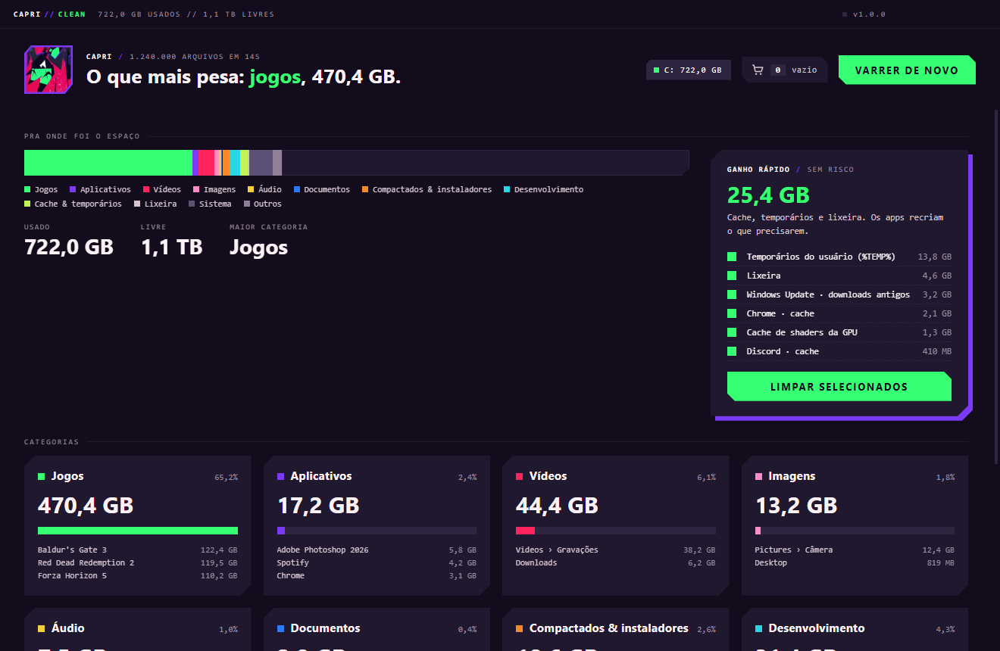
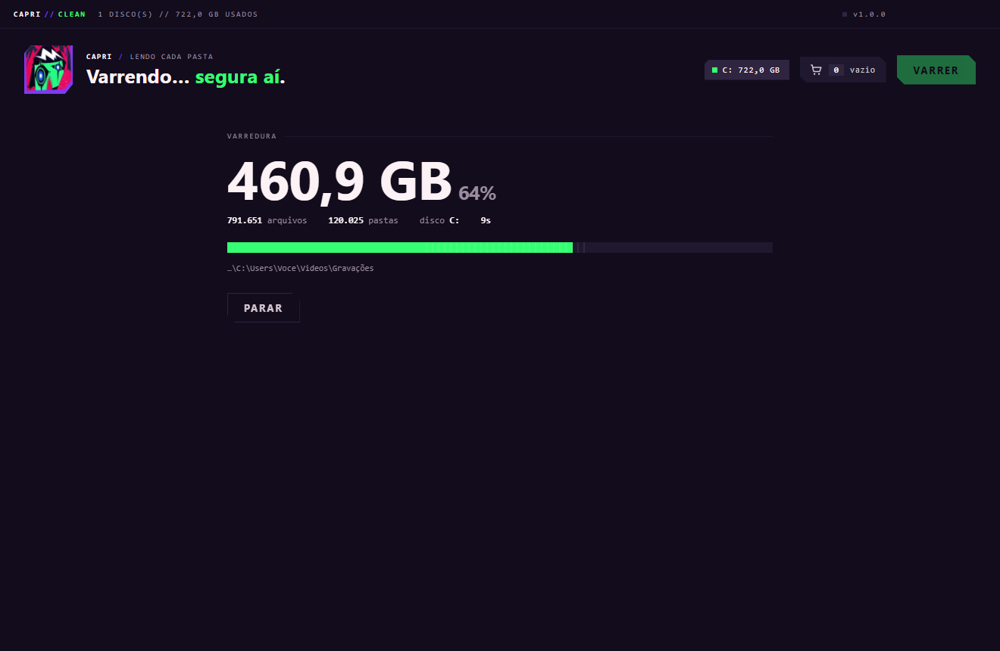
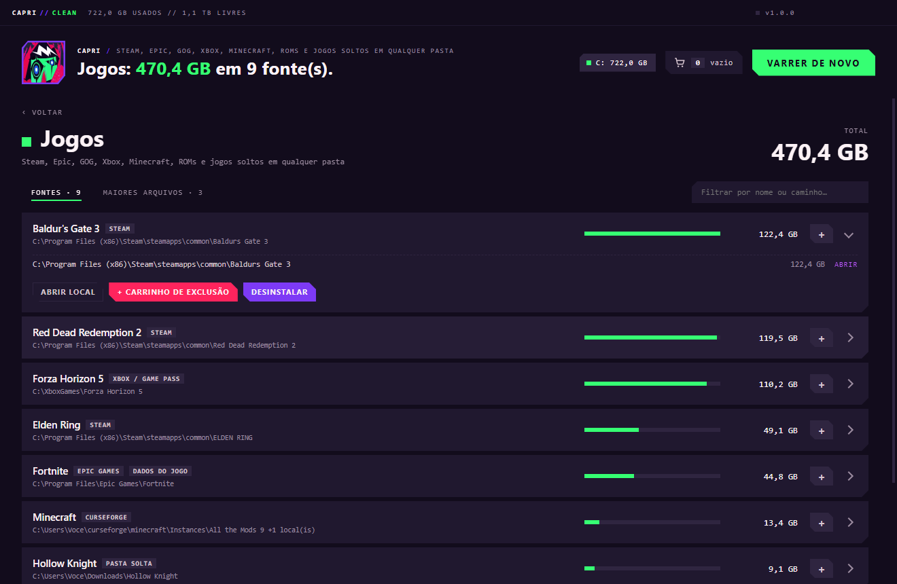
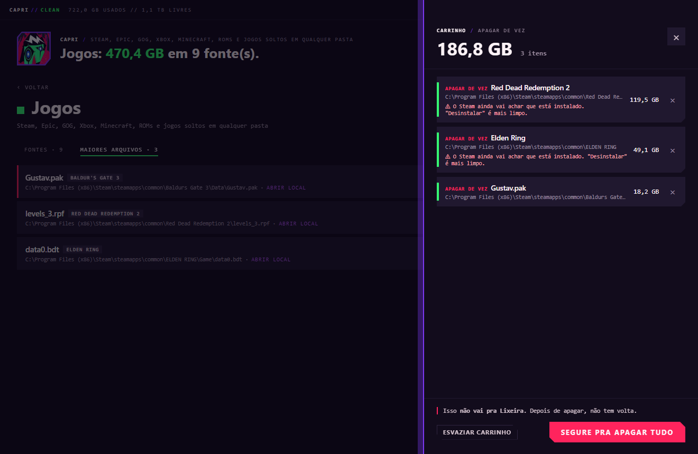

<div align="center">


# Capri Clean

**Descubra pra onde foi o espaço do seu PC e limpe sem medo.**

A Capri varre o disco inteiro, separa tudo em categorias (jogos, apps, vídeos, cache…) e mostra de onde vem cada gigabyte.
Até aquele jogo esquecido numa pasta da Downloads ela reconhece.

[](https://github.com/gabriel448/capri-clean/releases/latest)

[](https://github.com/gabriel448/capri-clean/releases)



</div>

---

## ⬇️ Instalar

1. Baixe o **`CapriClean-Setup-x.y.z.exe`** na [página de releases](https://github.com/gabriel448/capri-clean/releases/latest).
2. Abra o arquivo. Ele instala só pro seu usuário (não pede administrador) e cria um atalho na área de trabalho.
3. Na primeira vez, o Windows pode mostrar **"O Windows protegeu o computador"**. É porque o app não tem assinatura digital paga.
   Clique em **Mais informações → Executar assim mesmo**.

Pronto. Daqui pra frente **ele se atualiza sozinho** (veja [Atualizações automáticas](#-atualizações-automáticas)).

---

## ✨ O que ele faz

### 🔍 Varredura completa e rápida
Lê todos os arquivos do disco (mais de 1 milhão em menos de 1 minuto num SSD), sem travar a tela.
Você vê em tempo real quantos GB já foram lidos e em que pasta ela está.



### 🗂️ Tudo separado em categorias, e cada categoria nas suas fontes

| Categoria | O que entra |
|---|---|
| 🎮 **Jogos** | Steam, Epic, GOG, Xbox/Game Pass, Riot, EA, Ubisoft, Battle.net, Rockstar, Minecraft (CurseForge, Prism, Modrinth…), ROMs de emulador e **jogos soltos em qualquer pasta** |
| 🧩 **Aplicativos** | Programas instalados, apps portáteis e os dados que eles guardam no AppData |
| 🎬 **Vídeos** · 🖼️ **Imagens** · 🎵 **Áudio** · 📄 **Documentos** | Agrupados por onde estão: `Downloads`, `Documents › Faculdade`, `D: › Filmes`… |
| 📦 **Compactados & instaladores** | ZIP, RAR, 7z, ISO, setups e MSIs largados por aí |
| 💻 **Desenvolvimento** | `node_modules`, `.git`, venvs, Android SDK, Gradle, Docker, WSL, modelos de IA, cada projeto de código com o próprio nome |
| 🧹 **Cache & temporários** | `%TEMP%`, cache de navegador, de shaders da GPU, do Windows Update, dumps de erro… |
| 🗑️ **Lixeira** · ⚙️ **Sistema** · ❔ **Outros** | O resto, inclusive o `pagefile.sys`, medido certinho |

Clicando numa categoria você vê **cada fonte** com tamanho, caminho e etiquetas, e também a aba **Maiores arquivos**.



### 🧠 Ela entende o que é cada coisa
Nem todo jogo mora na pasta da Steam. A Capri reconhece um jogo pelo **motor** dele, onde quer que esteja:

- **Unity** (`UnityPlayer.dll`, `*_Data/Managed`), **Unreal** (`Engine/Binaries`, `Content/Paks`), **Godot**, **Ren'Py**, **RPG Maker**, **GameMaker**
- Bibliotecas típicas de jogo: Steamworks, Epic Online Services, GOG Galaxy, Bink, FMOD, PhysX, DLSS, FSR, Oodle
- Jogos ainda compactados ou como instalador, e dumps de console (`.pkg` de PS4, `.nsp`/`.xci` de Switch…)

Ela acha a pasta que realmente é o jogo (não a subpasta onde a DLL está) e dá um nome bonito:
`Hollow_Knight_v1.5.78-GOG` vira **Hollow Knight**.

### ⚡ Ganho rápido
Um card na tela inicial junta tudo que dá pra limpar **sem risco nenhum** (cache, temporários, lixeira) e libera tudo com um clique.

### 🛒 Carrinho de exclusão
Achou o que quer apagar? Clique no **+** da fonte ou do arquivo. Ele vai pro carrinho.
Quando terminar de escolher, abra o carrinho, revise tudo, e **segure o botão** pra apagar de vez (sem passar pela Lixeira).



- Ela avisa quando apagar não é a melhor ideia ("a Steam ainda vai achar que o jogo está instalado, prefira Desinstalar").
- **Arquivos em uso são pulados**, sem erro. Ela apaga todo o resto e diz quantos ficaram.
- Cada item mostra o progresso e quanto liberou.

### 🧰 Outras ações
- **Abrir local** de qualquer fonte ou arquivo
- **Desinstalar** pelo jeito certo: pela Steam, pelo desinstalador oficial registrado no Windows, ou pela tela de Apps do Windows
- **Esvaziar a Lixeira** e abrir a **Limpeza de Disco** do Windows (pra `Windows.old` e afins)

---

## 🛡️ Segurança
- **Nada é apagado sem você confirmar.** O carrinho exige segurar o botão por 1,4 s.
- **Pastas vitais são intocáveis**, mesmo se você tentar: Windows, Program Files, sua pasta de usuário, Downloads, Documentos, Área de Trabalho, AppData, OneDrive, a biblioteca da Steam…
- Pastas que misturam vários tipos de arquivo (como a Downloads inteira) não entram no carrinho de uma vez. Lá você escolhe arquivo por arquivo.
- Atalhos e junções de pasta nunca são seguidos: ela apaga o atalho, nunca o destino.

---

## 🔄 Atualizações automáticas
Toda vez que você abre o app, ele confere se tem uma versão nova aqui no GitHub:

1. Se tiver, baixa em segundo plano (o progresso aparece no topo da janela).
2. Quando termina: se você não estiver fazendo nada, ele **reinicia sozinho já atualizado**.
   Se estiver no meio de algo, aparece o botão **Reiniciar e atualizar**, ou ele instala quando você fechar.

---

## ❓ Perguntas frequentes

<details>
<summary><b>Precisa rodar como administrador?</b></summary>

Não. Algumas pastas do sistema não dão pra ler sem admin. Elas aparecem somadas em **Sistema › Áreas protegidas do sistema**, pra conta fechar com o que o Windows mostra.
</details>

<details>
<summary><b>Por que os números são um pouco diferentes do Explorer?</b></summary>

A Capri soma o tamanho real dos arquivos e não conta duas vezes os "hard links" do Windows (a pasta WinSxS, por exemplo). O total de usado/livre vem direto do Windows.
</details>

<details>
<summary><b>Os arquivos do OneDrive que estão só na nuvem contam?</b></summary>

Não. Arquivos "somente online" não ocupam espaço no disco, então ela pula.
</details>

<details>
<summary><b>Funciona com HD externo / mais de um disco?</b></summary>

Sim. Todos os discos aparecem no topo. Clique pra escolher quais varrer.
</details>

---

## 👩‍💻 Pra quem quer mexer no código

```bash
git clone https://github.com/gabriel448/capri-clean.git
cd capri-clean
npm install
npm start          # abre o app
npm run demo       # abre com um PC fictício (bom pra prints)
npm run scan:test  # varre o C:\ pelo terminal e imprime o resultado
```

### Como o projeto está organizado

```
src/
  main/
    main.js        janela, ações (apagar, limpar, desinstalar) e auto-update
    scanner.js     coordena a varredura (roda numa worker thread)
    walk.js        lê o disco rápido e junta as "pistas" de cada pasta
    classify.js    regras que decidem categoria e fonte de cada pasta
    taxonomy.js    categorias e extensões
    purge.js       exclusão arquivo a arquivo, pulando o que está em uso
    demo.js        dados do modo demo
  renderer/        a interface (HTML, CSS e JS puros)
  preload.js       ponte segura entre a interface e o sistema
```

**Quer ensinar a Capri a reconhecer algo novo?** Quase sempre é só mexer em `classify.js` (regras por caminho) ou em `walk.js` (arquivos e pastas que denunciam um jogo).

### Lançando uma versão nova
1. Mude `"version"` no `package.json` (ex.: `1.0.0` → `1.1.0`).
2. Faça commit e crie a tag com a **mesma versão**:
   ```bash
   git commit -am "Versão 1.1.0"
   git tag v1.1.0
   git push && git push --tags
   ```
3. O GitHub Actions gera o instalador e publica o release. Quem já tem o app recebe a atualização na próxima vez que abrir.

---

## 🎨 Créditos e direitos
- Visual baseado no [Capri Desktop](https://github.com/mochiiwuff/capri-desktop): paleta, tipografia (Chakra Petch + JetBrains Mono) e o recorte dos painéis.
- **Capri / Project Capricorn**, *Cyberpunk* e *Cyberpunk: Edgerunners* pertencem à **CD PROJEKT RED**, **Studio Trigger** e **Netflix**.
  Este é um projeto de fã, sem fins comerciais e sem afiliação. As imagens da personagem em `src/renderer/assets/` vêm do Capri Desktop
  e **não** estão cobertas pela licença MIT do código. Se algum detentor de direitos quiser que sejam removidas, é só abrir uma issue.
- Código sob a [licença MIT](LICENSE).
